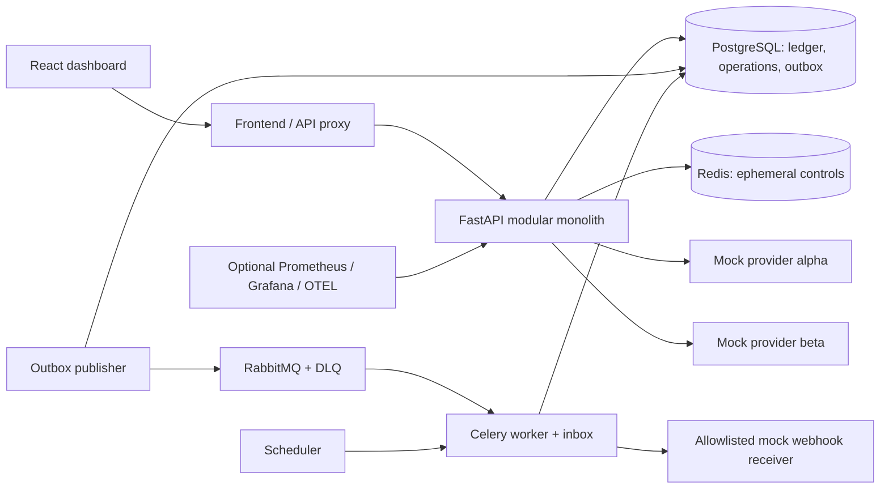
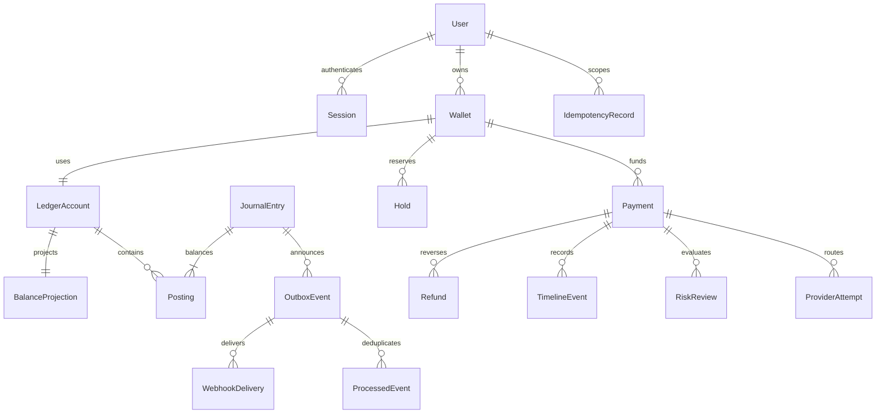

# LedgerFlow: продуктовая архитектура

Дата: 2026-11-24. Статус: проектное решение для реализации по [полному ТЗ](../requirements/MASTER_SPEC.md). Этот документ описывает целевое поведение; успешность реализации подтверждается тестами и записями в `PROGRESS.md`, а не наличием диаграммы.

## Границы системы

LedgerFlow — локальный FinTech sandbox с виртуальными RUB и синтетическими пользователями. Backend представляет собой модульный монолит на Python 3.13, FastAPI и SQLAlchemy 2. PostgreSQL хранит финансовую истину. Отдельные процессы выполняют публикацию outbox, обработку Celery и периодические задания. Два независимых локальных mock-провайдера и mock webhook receiver являются участниками демонстрации отказов, а не реальными финансовыми интеграциями.



React/TanStack Query использует настоящий `/api/v1`; локальные массивы разрешены для навигации и пояснений, но не для финансовых метрик, истории или результатов Chaos Lab. Конфигурация мониторинга выделяется в необязательный Compose-профиль. Все опубликованные порты привязываются к localhost.

## Модули и зависимости

- `auth/users`: Argon2id, access tokens, хешированные refresh tokens, сессии, ротация/отзыв, RBAC и объектные ограничения.
- `ledger`: счета, неизменяемые журналы и проводки, производные балансы; не знает о FastAPI и HTTP-провайдерах.
- `wallets`: ownership, блокировка кошелька, top-up, перевод и резервы; вызывает финансовое ядро.
- `payments`: автомат состояний, жизненный цикл резерва, capture, cancel и refund; координатор восстановления внешнего результата.
- `providers/risk`: локальные адаптеры, routing/circuit breaker и объяснимые правила. Они не меняют balance напрямую.
- `outbox/webhooks`: надёжный транспорт, inbox, журнал попыток, ограниченный retry и DLQ.
- `reconciliation/audit`: сверка неизменяемых фактов, расхождения, рекомендации и расследование по timeline.
- `chaos`: ограниченные sandbox-эксперименты над теми же сервисами. Результат вычисляется из записанных фактов и инвариантов.

Внутри модулей domain определяет правила, application — use cases и явную транзакцию, infrastructure — SQL/HTTP/broker adapters, presentation — валидацию и HTTP. Один небольшой модуль может использовать несколько файлов вместо формальной иерархии классов. HTTP-обработчики не содержат самостоятельных финансовых commit.

## Финансовая транзакция

Одна PostgreSQL-транзакция атомарно сохраняет ledger-проводки, согласованные проекции/резервы, новое состояние операции, audit/timeline, outbox и результат идемпотентности. Аккаунты блокируются в одном порядке UUID. Вызов HTTP-провайдера выполняется после commit; результат фиксируется в следующей восстанавливаемой транзакции. Подробные правила — в [ADR-0002](../adr/0002-financial-core.md).

`READ COMMITTED` с явными row locks применяется к финансовым ресурсам; это решение зависит от того, что все пути списания, резервирования, capture, release и refund соблюдают одну и ту же дисциплину. Для `40P01` и `40001` повторяется вся транзакция с новой сессией, ограниченным количеством попыток и jitter. Ошибку частичного запроса нельзя «исправлять» дополнительным независимым commit.

## Платёж как восстанавливаемый процесс

```mermaid
sequenceDiagram
  participant Client
  participant API
  participant DB as PostgreSQL
  participant Provider as Mock provider
  Client->>API: POST /payments + Idempotency-Key
  API->>DB: lock / risk / hold / payment / timeline / outbox / idempotency
  DB-->>API: commit
  API->>Provider: create with durable provider operation key
  alt Confirmed success
    Provider-->>API: SUCCEEDED + reference
    API->>DB: lock payment + accounts; capture once; commit
  else Response absent or ambiguous
    API->>DB: persist UNKNOWN + provider reference/key
    Note over API,Provider: No fallback and no release while outcome is ambiguous
    API->>Provider: later status lookup by the same operation key
  end
  API-->>Client: persisted payment representation
```

Положительный provider outcome и capture разделены отказоустойчивой границей. Между ними может произойти crash: после перезапуска status lookup и уникальный financial-effect key завершают capture без второго списания. Отсутствие HTTP-ответа клиенту не меняет committed результат. Порядок событий и обработка неопределённости закреплены в [ADR-0003](../adr/0003-delivery-and-unknown.md).

## Минимальная модель данных



Это логические связи, а не утверждение о наличии всех SQL foreign keys. Точные имена и ограничения должны быть сверены с Alembic-миграцией при интеграции.

## Доступ и доверие

Customer видит свои разрешённые кошельки и операции. Merchant получает доступ к своим merchant-ресурсам. Risk analyst принимает только решения review. Operator выполняет разрешённые эксплуатационные действия, administrator — административные операции. Проверка роли не заменяет проверку ownership. Административные изменения требуют аудита, UI не является границей безопасности.

Refresh cookie должна быть `HttpOnly`, с ограниченными path/SameSite и проверкой допустимого Origin для cookie-аутентифицированных операций. В production вне localhost нужен `Secure`; demo identities и небезопасные локальные transport-настройки допускаются только при явно включённом sandbox. Токены, пароли, webhook signing secrets и произвольные request bodies не попадают в логи/trace.

Процессы приложения не должны владеть схемой или иметь право отключать triggers. Наличие SQL-защиты от обычного DML не защищает от superuser/DDL-доступа. Разделение migration/runtime ролей должно проверяться по фактической Compose-конфигурации.

## Доказательства готовности

Последовательно нужны: чистые миграции, raw SQL проверки ограничений, PostgreSQL API/concurrency tests, property-based последовательности, recovery tests, реальный frontend E2E, Chaos Lab и измеренная нагрузка. Цели покрытия: ledger не менее 90%, backend не менее 80%; проценты публикуются только после измерения. Bootstrap HTML и его прежние четыре теста не являются доказательством готовности продукта.
